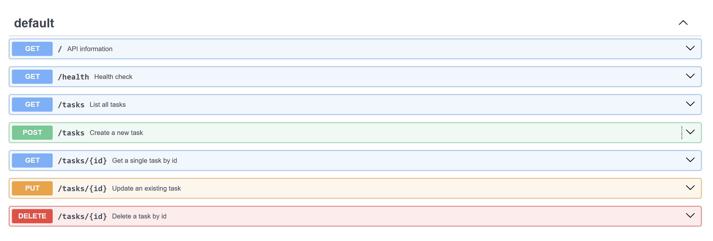

# Task API

A small REST API for managing a to-do list, built with FastAPI. It supports the four CRUD operations — create, read, update and delete tasks — with proper HTTP status codes and input validation.

Tasks are stored **in memory** (a Python list), so all data resets when the server restarts. This is intentional: persistence comes later in the track.

Built by hand for FlyRank Internship, Backend Track, Week 2, Assignment A1.

## Requirements

- Python 3.10 or newer
- FastAPI (installed below)

## Install and run

```bash
git clone https://github.com/asingh061/CRUD_API.git
cd CRUD_API
python -m venv .venv
source .venv/Scripts/activate      # Windows (Git Bash)
# source .venv/bin/activate        # macOS / Linux
python -m pip install "fastapi[standard]"
fastapi dev main.py
```

The server starts on `http://localhost:8000`.

Interactive documentation is at `http://localhost:8000/docs`.

## Endpoints

| Method | Path | Description | Success | Errors |
|--------|------|-------------|---------|--------|
| GET | `/` | API information | 200 | — |
| GET | `/health` | Health check | 200 | — |
| GET | `/tasks` | List all tasks | 200 | — |
| GET | `/tasks/{id}` | Get a single task by id | 200 | 404 unknown id |
| POST | `/tasks` | Create a new task | 201 | 400 empty title |
| PUT | `/tasks/{id}` | Update a task's title and/or done status | 200 | 400 empty body · 404 unknown id |
| DELETE | `/tasks/{id}` | Delete a task by id | 204 | 404 unknown id |

### Task shape

```json
{ "id": 1, "title": "Buy milk", "done": false }
```

- `POST /tasks` expects `{ "title": "..." }`. The server assigns the next free `id` and sets `done` to `false`.
- `PUT /tasks/{id}` accepts `title`, `done`, or both. At least one must be present.

## Example requests

Creating a task:

```
$ curl -i -X POST http://localhost:8000/tasks -H "Content-Type: application/json" -d '{"title":"Buy milk"}'

HTTP/1.1 201 Created
date: Mon, 19 Oct 2026 16:13:31 GMT
server: uvicorn
content-length: 40
content-type: application/json

{"id":4,"title":"Buy milk","done":false}
```

Requesting a task that does not exist:

```
$ curl -i http://localhost:8000/tasks/99

HTTP/1.1 404 Not Found
date: Mon, 19 Oct 2026 16:00:52 GMT
server: uvicorn
content-length: 30
content-type: application/json

{"detail":"Task 99 not found"}
```

Deleting a task:

```
$ curl -i -X DELETE http://localhost:8000/tasks/3

HTTP/1.1 204 No Content
date: Mon, 19 Oct 2026 19:56:58 GMT
server: uvicorn
content-type: application/json
```

## Swagger UI

Every endpoint is listed at `/docs` with a "Try it out" button that sends real requests. The full CRUD cycle works from this page without touching curl.



## Notes

**Error format.** Errors come back as `{"detail": "..."}` rather than `{"error": "..."}`. `detail` is FastAPI's convention for `HTTPException`, and matching the assignment's example exactly would require a custom exception handler.

**Missing vs empty title.** A `POST` with no `title` field at all returns **422**, because Pydantic rejects the body before the route function runs. A `POST` with a `title` that is empty or only whitespace returns **400** from the validation check in the route. Both are rejections; they just happen at different layers.